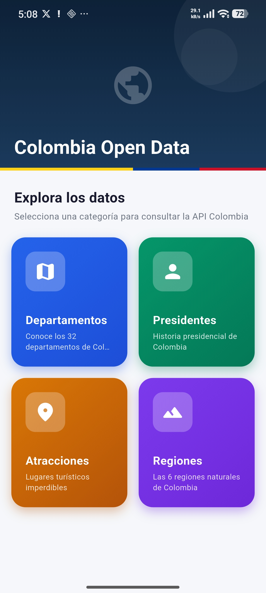
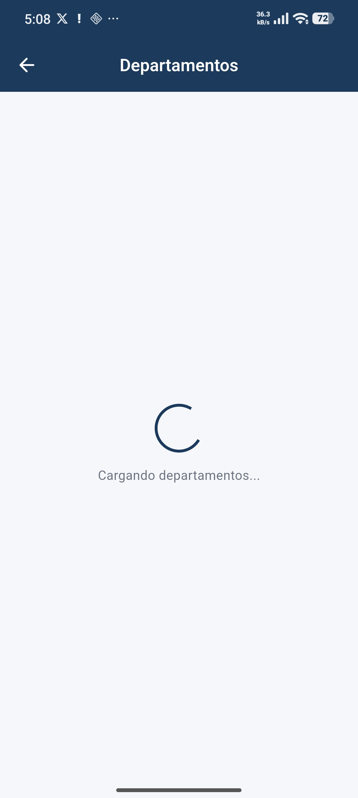
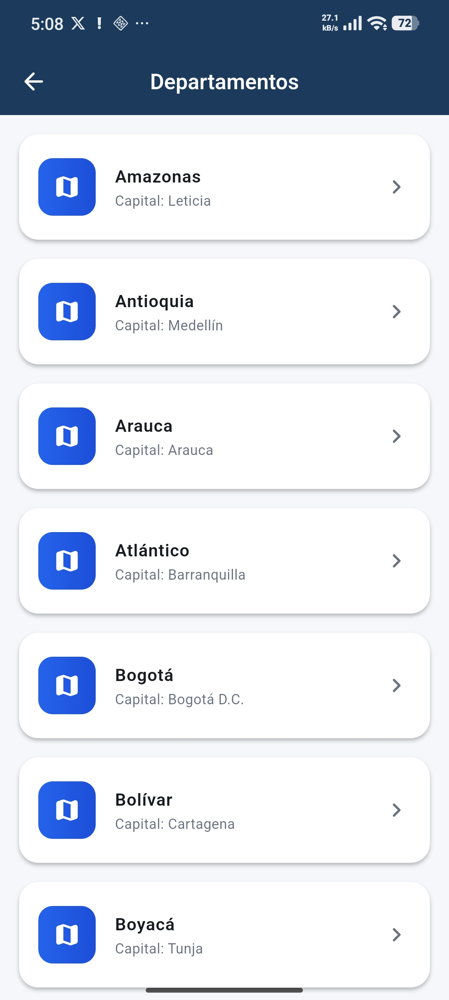

# Colombia Open Data

Aplicación **Flutter** que explora datos abiertos de Colombia consumiendo la [API Colombia](https://api-colombia.com/). Permite consultar **departamentos**, **presidentes**, **atracciones turísticas** y **regiones** desde una interfaz Material 3, con navegación declarativa y estados explícitos de carga y error.

[](https://github.com/jose-alejandro-loaiza-lopez/parcial_2_datos_abiertos/actions/workflows/deploy-pages.yml)
[](https://flutter.dev/)
[](https://jose-alejandro-loaiza-lopez.github.io/parcial_2_datos_abiertos/)
[](./LICENSE)

## Demo

**https://jose-alejandro-loaiza-lopez.github.io/parcial_2_datos_abiertos/**

La aplicación se publica como build web de Flutter en GitHub Pages. También puede ejecutarse en Android e iOS desde el mismo código.

## Capturas

| Dashboard | Departamentos | Detalle |
|-----------|---------------|---------|
|  |  |  |

## Funcionalidades

- **Dashboard** con cuatro categorías y acceso directo a cada sección.
- **Departamentos**: listado alfabético con capital y detalle con población, superficie, municipios e indicativo.
- **Presidentes**: historia presidencial con nombre completo, periodo, partido político e imagen.
- **Atracciones turísticas**: listado con imagen principal, ciudad y coordenadas.
- **Regiones**: las seis regiones naturales de Colombia con su descripción.
- Manejo de **tres estados por vista**: cargando, error con reintento y datos.
- Navegación declarativa con `go_router` y rutas anidadas de detalle.
- Tema Material 3 con la paleta inspirada en la bandera de Colombia.
- Pruebas unitarias y de widgets sobre modelos, widgets compartidos, dashboard y rutas.
- Pipeline de GitHub Actions con análisis, pruebas, build web, despliegue y verificación.

## API consumida

**Base URL:** `https://api-colombia.com/api/v1`

| Endpoint | Uso en la aplicación |
|----------|----------------------|
| `/Department` | Listado y detalle de los departamentos |
| `/President` | Listado y detalle de presidentes |
| `/TouristicAttraction` | Listado y detalle de atracciones turísticas |
| `/Region` | Listado y detalle de regiones naturales |

La URL base se configura en `.env`:

```env
API_BASE_URL=https://api-colombia.com/api/v1
```

## Arquitectura

```text
lib/
├── config/app_config.dart            # Lectura de variables de entorno
├── models/                           # Department, President, Region, TouristicAttraction
├── routes/app_router.dart            # Rutas con go_router
├── services/
│   ├── api_service.dart              # Cliente HTTP genérico y manejo de status codes
│   └── colombia_service.dart         # Servicios por dominio
├── themes/app_theme.dart             # Tema Material 3
├── views/                            # Dashboard, listados y detalles
├── widgets/                          # DashboardCard, LoadingWidget, ErrorDisplay
└── main.dart                         # Punto de entrada
```

### Capas

- **models**: cada modelo expone `fromJson` y `toJson`, con manejo de campos opcionales.
- **services**: `ApiService` centraliza las peticiones HTTP; los servicios por dominio transforman la respuesta en modelos tipados.
- **views**: cada pantalla gestiona los estados de carga, error y éxito mediante `FutureBuilder`.
- **widgets**: componentes reutilizables para tarjetas, carga y error.
- **routes**: rutas nombradas con `go_router`, incluyendo el detalle de cada sección.

## Stack

| Capa | Tecnología |
|------|------------|
| Framework | Flutter 3.44 (Dart 3.12) |
| Navegación | go_router |
| HTTP | package:http |
| Configuración | flutter_dotenv |
| Pruebas | flutter_test |
| CI/CD | GitHub Actions |
| Publicación | GitHub Pages (Flutter web) |

## Requisitos

- Flutter 3.44 o superior (canal stable)
- Dart 3.12 o superior incluido con Flutter
- Chrome para ejecutar la versión web en desarrollo

## Desarrollo local

```bash
flutter pub get
flutter run -d chrome
```

Para ejecutar en un dispositivo o emulador Android:

```bash
flutter run
```

## Pruebas

```bash
flutter analyze
flutter test
```

Las pruebas cubren la conversión de los cuatro modelos, los widgets compartidos, el dashboard y la configuración de rutas.

## Build web

```bash
flutter build web --release --base-href "/parcial_2_datos_abiertos/"
```

El resultado queda en `build/web`.

## CI/CD

El workflow [`deploy-pages.yml`](./.github/workflows/deploy-pages.yml) se ejecuta en cada push a `main` y realiza:

1. Instalación de Flutter con caché.
2. `flutter pub get`.
3. `flutter analyze`.
4. `flutter test`.
5. Build web de producción con el `base-href` del repositorio.
6. Publicación del artefacto en GitHub Pages.
7. Verificación de la URL publicada mediante `curl`, comprobando que el sitio responde con el contenido esperado.

## Autor

**José Alejandro Loaiza López**
- GitHub: [@jose-alejandro-loaiza-lopez](https://github.com/jose-alejandro-loaiza-lopez)
- Universidad: Unidad Central del Valle del Cauca (UCEVA)
- Ubicación: Tuluá, Valle del Cauca, Colombia

## Licencia

Este proyecto está bajo la licencia [MIT](./LICENSE).
